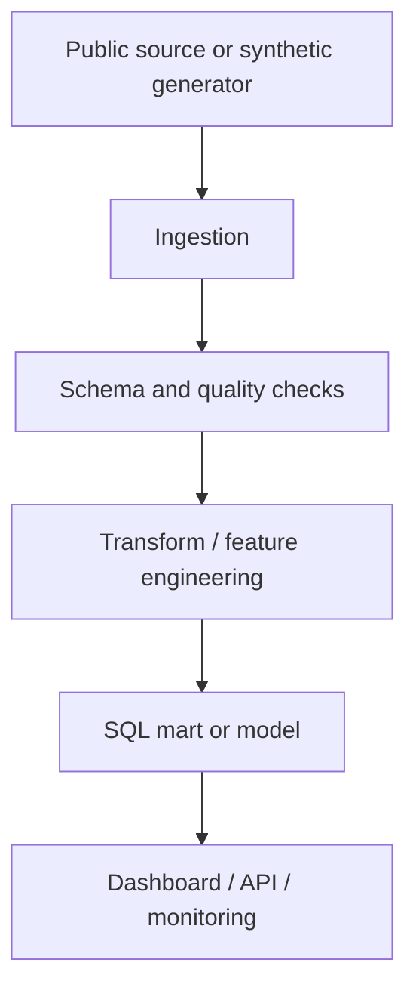

# Architecture notes

UPI Pulse: India's Digital Payments Intelligence Platform

For a production extension, add secrets management, orchestration, observability, data lineage, access control, retention policy and CI/CD.
